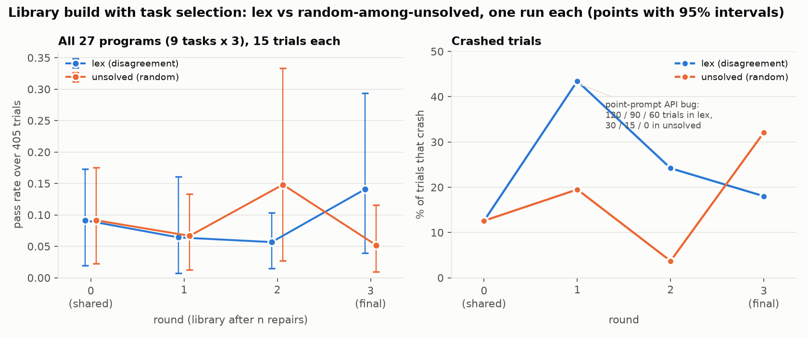
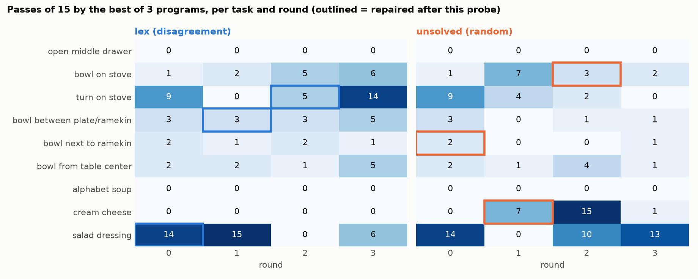
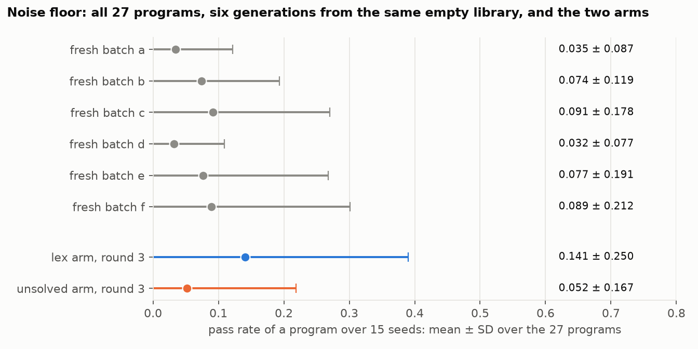

# Library build with task selection: first comparison and noise floor

Date: 2026-10-14 onwards. One RTX 5090. Model: `claude-sonnet-5` for every writer and repair agent.
Figures: `figs/` (make them with `make_figures.py`). Code: `scripts/taskselect/library_loop.py`.

## Summary

- We built a skill library from nothing in two ways, one run each: the next task to repair chosen by
  **disagreement** (`lex`), and chosen **at random among unsolved tasks** (`unsolved`).
- **No difference can be claimed.** Each round runs 27 programs (9 tasks x 3) for 15 trials each, 405 trials. The final pass
  rate is 0.141 (`lex`) against 0.052 (`unsolved`), but three independent generations of the *same* empty library already
  range from 0.035 to 0.091, and every 95% interval of the gap contains 0.
- Two clear library effects were seen, one in each arm, and both are real mechanisms, not selection effects:
  a perception rule that was used and helped, and a perception prompt that helped and then was not reused.
- A pipeline defect (point-prompt API misuse, never fixed in the writers' instructions) crashed up to 30% of the `lex` trials in
  rounds 1 to 3. It biases the comparison against `lex`. It is fixed in all later runs.

- **Three repetitions with 30 seeds and 5 repairs (section 6):** no evidence that `lex` beats `unsolved`. Final gap +0.074 with the
  first 3 programs per task (p = 0.13) and +0.022 with 6 programs per task (p = 0.48). The experiment has low power: with
  3 repetitions a true gap of 0.10 is detected about 40% of the time.

## Proposition and hypotheses

**Setting.** A language model writes a Python program for a robot task from a skill library (markdown files of rules and
helpers). When programs fail, an agent repairs one task, and the lesson is written back into the library. The library is the
only thing that carries knowledge from one round to the next. Repairing is expensive (about an hour of agent and simulator
time per task), so a build repairs only a few tasks. **Which task to repair next decides what the library learns.**

**Proposition.** The most informative task to repair is the one where the current programs **disagree**: some pass and some
fail on the same seeds, many unsolved tasks fail at the same stage, and the failures have varied traces. Disagreement says that
the task is neither hopeless nor already solved, and that a fix at a shared failure stage will carry over to other tasks.
Repairing by this rule (`lex`) should build a better library than repairing a random unsolved task (`unsolved`) at the same
number of repairs.

**Hypotheses** (all about the library after the same number of repairs, same tasks, same writers):

| id | statement | measure | how it can fail |
|---|---|---|---|
| H1 (primary) | the final library of `lex` gives a higher pass rate than that of `unsolved` | mean pass rate over 27 programs (9 tasks x 3), and over 6 programs per task, on 30 seeds | gap within the noise, or negative |
| H2 | `lex` improves a library faster along the rounds | gain over round 0, mean over rounds 1 to 5 | no gain difference |
| H3 | `lex` lessons transfer: tasks that were not repaired improve | per-task passes, unrepaired tasks | gains only on repaired tasks |
| H0 (noise) | one run's mean moves by 0.03 (SD) with no change in the library, so an effect smaller than the detectable gap cannot be shown | six round-0 generations from the empty library | (this is a measured fact, not a claim) |

**What can be concluded.** The power of the experiment is given in section 6.4. Short version: with 3 repetitions, 9 tasks and
the measured noise, a true gap of 0.10 is detected only about 40% of the time (80% power needs a gap of about 0.17); with 5
repetitions about 80%. A result below the detectable gap is reported as "not shown", not as "no effect".

## Method: the library, the loop and the update rule

**The library.** Markdown files in `.claude/libero/skills/` (`grasp`, `localize`, `manipulation`, `transport`, `README`).
Writers read them as context; programs never import them. A build starts from the empty library `L00`, and each repair
produces the next one (`L01`, `L02`, ...). Every version is stored in `outputs/<run>/library/Lnn`.

**Algorithm.**

```
L <- empty library
repeat 5 times:
    P <- 3 fresh programs per task, written from L          # 9 tasks
    run P on seeds 51..80                                   # 810 trials
    U <- tasks where no program passes every seed
    t <- pick(U)                                            # the only difference between arms
    findings <- repair(t)                                   # up to 5 tries, dev seeds 51..65
    L <- L + lessons(findings)                              # add rules, never remove
final: 3 fresh programs per task from L, run on seeds 51..80

pick(U), arm "unsolved":  a random task of U
pick(U), arm "lex":       the task of U with the largest (split, shares, trace), compared in that order
    split  = how much programs disagree per seed (entropy of how many pass)
    shares = how many tasks of U fail at the same stage
    trace  = how varied the failure traces are
```

A trial's failure stage comes from its API trace only: `crash`, `perceive` (object not found), `no_motion`, `no_close`, `air`
(closed on nothing), `slip` (held, then lost), `held_end`, `released` (placed wrong). `LEX.md` has a worked example.

**Repair.** The agent reads the passing and failing traces of the task's 3 programs, then writes up to 5 task-level programs
(no seed branches, no hard-coded coordinates), each run on the 15 dev seeds and diagnosed from its failed trials. The kept
program is the one with the most passes (ties: the later one). It writes `findings.md`: root causes, pass counts and
"Generalizable Patterns".

**Library update rule (promotion).** After the repair, the coordinator reads `findings.md`, edits the skill files and logs it in a
ledger (`skill_promotions.jsonl`: files changed, reason). Rules in force:
1. A lesson is added as a short rule with its trigger and evidence, in the file of its category (grasp, localise, place,
   carry). Generic patterns are preferred over task facts.
2. No rule is ever removed or corrected: the library only grows (4.7 KB after the first repair, 17.6 KB after five in one run).
3. The kept program's pass count on the dev seeds is the only evidence required; there is no test on other seeds.
4. Skills may use the allowed APIs only (no simulator state, no `.bddl`/`.xml` reads).

**Protocol and controls.**

| item | value |
|---|---|
| pool | 9 swap tasks: goal (3), spatial (3), object (3); 21 more swap tasks are held out and unused so far |
| probe seeds | 51-80 (30), every round; repair development seeds are 51-65 |
| repetition | round 0 is written once and shared by both arms; arm order alternates; 5 repetitions planned |
| same in both arms | model (`claude-sonnet-5`), K, writers' prompts, repair budget, seeds, API facts note |
| differs | only the selection rule |
| noise control | six independent round-0 generations from the empty library, and a re-measurement of each final library with 3 more programs per task |

## Setup

| item | value |
|---|---|
| pool | 9 swap tasks: goal (3), spatial (3), object (3), `library_9_swap` |
| start | empty skill library `L00`; round 0 shared by both arms (27 programs, 9 patched by hand for API errors, see Defects) |
| per round | 3 fresh zero-shot programs per task from the current library, probed on seeds 51-65 (405 trials) |
| repair | one task per round, up to 5 iterations from its best program, then skill promotion |
| rounds | 3 repairs, then a final probe (4 probes per arm) |
| selection | `lex`: highest per-seed split, then most tasks sharing the failure stage, then trace variety (explained, with a worked example, in `LEX.md`). `unsolved`: uniform among tasks with no program passing 15 of 15 |
| differences between arms | `unsolved` probed with 4 workers, `lex` with 2 (speed only; outcomes are not deterministic at either) |

## 1. The two arms



| round | `lex` pass rate | `unsolved` pass rate | `lex` crashed trials | `unsolved` crashed trials |
|---|---|---|---|---|
| 0 (shared) | 0.091 | 0.091 | 13% | 13% |
| 1 | 0.064 | 0.067 | 43% | 19% |
| 2 | 0.057 | 0.148 | 24% | 4% |
| 3 (final) | 0.141 | 0.052 | 18% | 32% |

- "Pass rate" is the passes of all 27 programs (9 tasks x 3 programs, 15 trials each) divided by the 405 trials.
- The best program per task is not used as a metric: a maximum over 3 noisy programs moves by 0.07 to 0.09 between identical
  generations.
- Solved tasks (one program passes 15 of 15): at most 1 of 9 in any round, in both arms.
- Repairs: `lex` picked salad dressing, bowl between plate and ramekin, turn on the stove. `unsolved` picked bowl next to the
  ramekin, cream cheese, bowl on the stove. Each arm solved one of its three repair tasks.
- The sign of the difference flips between rounds (+0.089 in round 3, -0.091 in round 2).



The per-task view (passes of 45 trials: 3 programs x 15 seeds) shows how unstable single tasks are: salad dressing in `lex`
goes 14, 18, **0**, 6; cream cheese in `unsolved` goes 0, 8, **36**, 1. Neither can be explained by the library alone.

## 2. Noise floor



Six independent generations of programs from the same empty library, same pool, same seeds (51-65). Each generation is 27
programs (9 tasks x 3) with 15 trials each, 405 trials. The plot shows, for each generation and for the final round of each
arm, the mean and SD over the 27 programs of each program's pass rate (passes of 15).

| generation | mean ± SD over the 27 programs | passes of 405 |
|---|---|---|
| fresh batch a | 0.035 ± 0.087 | 14 |
| fresh batch b | 0.074 ± 0.119 | 30 |
| fresh batch c | 0.091 ± 0.178 | 37 |
| fresh batch d | 0.032 ± 0.077 | 13 |
| fresh batch e | 0.077 ± 0.191 | 31 |
| fresh batch f | 0.089 ± 0.212 | 36 |
| `lex`, round 3 | 0.141 ± 0.250 | |
| `unsolved`, round 3 | 0.052 ± 0.167 | |

- The SD is large against the mean: most programs pass 0 of 15 and a few pass most seeds.
- The mean of the six generations is 0.066; the SD between generations is 0.026. That is the noise on one run's mean.
- The two arms start from a round 0 that was written once and shared; 9 of its programs needed a hand patch for API errors (see
  Defects), so it is not used in this noise estimate.
- Execution noise adds to this: re-running identical programs on the same seeds changed 11 of 15 per-seed outcomes for one
  program (earlier control).

**Reading the arms against this.** The difference between two single runs has an SD of about 0.04 (0.026 x sqrt 2 = 0.037).

| round | gap `lex` - `unsolved` | 95% interval (same tasks, seeds resampled) |
|---|---|---|
| 1 | -0.002 | [-0.101, 0.121] |
| 2 | -0.091 | [-0.291, 0.052] |
| 3 (final) | +0.089 | [-0.032, 0.269] |

All three intervals contain 0. The final-round gap is about 2 noise SDs, but it appears in **both directions** (round 2 favours `unsolved` by the
same amount). With one run per arm, three noise points and several metrics and rounds looked at, that cannot be read as an
effect of the selection rule. It does show that library changes or generation variance move the metric by that much between
rounds. A comparison needs several repetitions per arm, which is what the campaign now running provides.

## 3. The two libraries

| | `lex` (L03) | `unsolved` (L03) |
|---|---|---|
| files | grasp, localize, manipulation, transport, README: 18 KB | localize, manipulation: 15 KB |
| edits | additions only, no rule removed or corrected | additions only |
| general rules | grasp plausibility filter; proprioceptive grasp check; min-thickness filter; landmark exclusion | out-of-vocabulary prompts are not "absent"; wrist-camera re-localisation with a displacement gate; floor-based drop height; learned planner then forced top-down |
| task-specific | push-flick for the stove knob; `DROP_CLEARANCE = 0.11` | gate values 0.08 and 0.12 m with the cream-cheese basket as evidence |

Neither library is clearly better. `lex` covers more skill categories because its three repairs hit different failure kinds.

## 4. Which library elements measurably helped

| element | evidence | verdict |
|---|---|---|
| **min-thickness filter** (`lex`, from the stove repair) | no round-1 or round-2 stove program implements a thickness filter (one comment mentions "flat"); all three round-3 programs do; passes 0/1/5 become 8/10/14 | best evidence in the data |
| **describe by appearance** (`unsolved`, from the ramekin repair) | all 3 cream-cheese programs in rounds 1 and 2 use the prompt "white and blue box"; round 2 passes 11/15/10 | helped, then lost: no round-3 program used it (1 pass of 45), with the rule still in the library |
| learned planner then forced top-down (`unsolved`, round 2) | programs calling `plan_grasp` rose from 13 to 19 of 27; "No grasp candidates found" 31 times, "All grasp attempts failed" 31 times; crashed trials 4% to 32% | correlation only; harmful in that round |
| drop clearance, yaw fallbacks | no durable effect | neutral |

Why a better element appeared at all:

1. **The valuable elements are perception diagnoses**: why the object was not found or was wrongly picked. Control tweaks
   (clearances, yaw fallbacks, planner settings) gave variable results.
2. **A repair's apparent gain can be pure noise.** In the stove repair, iterations 2 and 5 are byte-identical programs (checked with
   `cmp`) and scored 7/15 and 13/15; the agent itself promoted a caution about this.
3. **Knowledge is not reliably reapplied.** A prompt that worked in two rounds was unused in the third with the library
   unchanged. The library stored the rule, not the concrete prompt; writers are not required to follow it.

## 5. Defects and deviations (read before trusting the numbers)

- **Point-prompt API misuse recurred in every later round.** The function takes one `(x, y)` pair; programs passed a list. The
  allowed-API list in `CLAUDE.md` says `points`, which invites it. I patched round 0 by hand and did not add the warning to
  the writers' instructions as intended. Trials with the resulting 422 error:

  | arm | round 1 | round 2 | round 3 |
  |---|---|---|---|
  | `lex` | 120 | 90 | 60 |
  | `unsolved` | 30 | 15 | 0 |

- **Round 0 of the two arms was patched by hand** (9 programs: missing `import numpy as np`, list-wrapped point prompt, dict passed as
  a mask); later rounds and the noise batches were not.
- **Molmo is off**, as in the upstream TC1 runs. It was removed from 11 round-0 programs and the writers were told not to use it.
- **Worker count** differed between the arms (2 against 4); a control showed it is not a source of bias.
- **One run per arm.** Nothing here is a significance statement.

## 6. Three repetitions of both arms (30 seeds, 5 repairs)

**Design.** Same pool of 9 tasks, 3 programs per task and same rules in both arms; every probe uses **30 seeds (51-80)**, each arm makes
**5 repairs** (6 probes). The writers' prompts carry the API facts (point prompt takes one `(x, y)` pair, `import numpy as np`, no
Molmo). In each repetition round 0 is written once and shared by both arms, and the arm order alternates. A second measurement
re-measures each final library with 3 more programs per task (6 in total, `remeasure.py`). Reps 4 and 5 are running with a
10-seed probe and are not in this section.

### 6.1 Mean pass rate over the 27 programs, by round (all 30 seeds)

| run | 0 | 1 | 2 | 3 | 4 | 5 |
|---|---|---|---|---|---|---|
| `lex` rep 1 | 0.028 | 0.062 | 0.081 | 0.048 | 0.083 | 0.147 |
| `unsolved` rep 1 | 0.028 | 0.063 | 0.133 | 0.049 | 0.094 | 0.115 |
| `lex` rep 2 | 0.078 | 0.152 | 0.091 | 0.104 | 0.072 | 0.159 |
| `unsolved` rep 2 | 0.078 | 0.007 | 0.070 | 0.177 | 0.117 | 0.100 |
| `lex` rep 3 | 0.100 | 0.067 | 0.131 | 0.086 | 0.017 | 0.152 |
| `unsolved` rep 3 | 0.100 | 0.070 | 0.091 | 0.009 | 0.036 | 0.022 |

Final round on seeds 66-80 only (no repair used these seeds): `lex` 0.138, 0.165, 0.153; `unsolved` 0.121, 0.094, 0.025.

### 6.2 `lex` against `unsolved`

| rep | gap, final round, first 3 programs | `lex`, 6 programs | `unsolved`, 6 programs | gap, 6 programs | 95% interval of that gap (tasks and seeds resampled) | gap in the mean of rounds 1 to 5 |
|---|---|---|---|---|---|---|
| 1 | +0.032 | 0.110 | 0.120 | -0.009 | [-0.144, +0.117] | -0.007 |
| 2 | +0.059 | 0.104 | 0.101 | +0.002 | [-0.099, +0.088] | +0.021 |
| 3 | +0.130 | 0.098 | 0.026 | +0.072 | [-0.003, +0.215] | +0.045 |
| mean ± SD | +0.074 ± 0.051 | | | +0.022 ± 0.044 | | +0.020 ± 0.026 |
| paired t-test (2 dof) | t = 2.52, p = 0.13 | | | t = 0.86, p = 0.48 | | t = 1.34, p = 0.31 |

- **No significant difference.** Every p-value is above 0.1, and the best result (final round, first 3 programs) is not significant.
- **The `lex` lead in the first 3 programs shrinks with 3 more programs:** the new `lex` programs score 0.074, 0.048 and 0.044
  against 0.147, 0.159 and 0.152 for the originals, while the `unsolved` ones match their originals. The 6-program measure is the
  better estimate, and it gives a mean gap of +0.022.
- **Rep 3:** `unsolved` is genuinely low (6-program measure 0.026; 0.022 with the original 3 and 0.030 with the new 3), partly through
  crashed trials in its middle rounds (31% in round 3). That is most of the remaining gap.
- All six runs end above or near their round 0 except `unsolved` rep 3 (0.100 to 0.022).

### 6.3 Measured standard deviations

| quantity | value | source |
|---|---|---|
| SD between independent empty-library generations (mean pass rate of 27 programs) | **0.026** | 6 generations, 15 seeds |
| SD of one program's pass rate (writer luck + seeds) | 0.15 (writer luck alone about 0.16) | same generations |
| SD from sampling seeds only, for a run's mean | 0.005 to 0.008 | bootstrap, 30 seeds |
| SD of the difference of two single runs | 0.037 | 0.026 x sqrt 2 |
| SD of the round-to-round change within a run | 0.059 | 30 steps over the 6 runs; pure measurement noise would give 0.037, so libraries and crashes add about 0.046 |
| SD across builds of the 6-program final pass rate | `lex` 0.006, `unsolved` 0.050; build-to-build SD (pooled, after removing measurement noise) about **0.03**, range 0 to 0.06 | 3 builds per arm; very uncertain (4 degrees of freedom) |
| SD of the gap across the 3 repetitions | 0.051 (3 programs), 0.044 (6 programs) | table 6.2 |

### 6.4 Power of this experiment

A paired t-test over `R` repetitions has power that depends on the SD of one repetition's gap,
sqrt(2 (sigma_b^2 + V_e)), where sigma_b is the build-to-build SD above and V_e = (0.025 + 0.04/S) / (tasks x programs) is the
measurement variance (derivation in `POWER.md`). Level 5% (a false alarm 1 time in 20), power = the chance of detecting a true
gap of the given size.

| measurement | build SD | SD of one gap | smallest gap with 80% power, 3 reps | power for a true gap of 0.10, 3 reps | power for 0.05, 3 reps | smallest gap with 80% power, 5 reps | power for 0.10, 5 reps |
|---|---|---|---|---|---|---|---|
| 6 programs x 9 tasks x 30 seeds | 0.015 | 0.038 | 0.123 | 66% | 26% | 0.064 | 99% |
| 6 programs x 9 tasks x 30 seeds | **0.03** | **0.053** | **0.172** | **44%** | **17%** | **0.089** | **88%** |
| 6 programs x 9 tasks x 30 seeds | 0.06 | 0.090 | 0.295 | 21% | 9% | 0.152 | 47% |
| 3 programs x 9 tasks x 30 seeds | 0.03 | 0.061 | 0.200 | 36% | 14% | 0.103 | 78% |

- **Our result is not informative about small effects.** With 3 repetitions and the central build SD (0.03), only a gap of about
  0.17 or more would be detected 80% of the time; a true gap of 0.10 is detected 44% of the time and 0.05 only 17%. The observed gap
  (+0.022 with 6 programs) is far below that.
- **Earlier numbers in this report were optimistic.** The detectable gaps of 0.106, 0.075 and 0.061 for 1, 2 and 3 repetitions used
  only the generation noise and a normal approximation; they ignore the build-to-build SD and the few degrees of freedom of the
  t-test.
- **To detect a gap of 0.10 reliably** with this measurement one needs about 5 repetitions (88% at the central build SD); for
  0.05 about 9 (see `POWER.md`). More programs, tasks or seeds in the measurement help little, because the build-to-build
  noise does not shrink with them.

## Where things are, by experiment id

All paths are under `aspire/sim/outputs/` (gitignored). The live directory `.claude/libero/skills/` is only a working
copy: each run saves its own libraries, so it is restored to the committed version when no run is active.

| experiment id | what it is | libraries | probes and selections | repairs |
|---|---|---|---|---|
| `library_lex_r1` | arm `lex`, 3 repairs + final probe | `library/L00` (empty) to `L03` | `round_NN/probe.json`, `round_NN/selection.json` | `round_NN/fixloop/<suite>/<task>/findings.md`, `skill_promotions.jsonl` |
| `library_unsolved_r1` | arm `unsolved` (also holds the shared round 0) | `library/L00` to `L03` | same | same |
| `library_noise_a`, `library_noise_b` | fresh round-0 generations from the empty library | `library/L00` | `round_00/probe.json` | none |
| `library_lex_r2`, `library_unsolved_r2` | pilot repetition 2 (15 seeds, 3 repairs; shared round 0) | `library/L00` to `L03` | same | same |
| `library_lex_s30_r<k>`, `library_unsolved_s30_r<k>` | campaign (k = 1 to 3 in section 6; 4 and 5 running with a 10-seed probe, ids `_s10_r<k>`); `outputs/remeasure/<run>` holds the 3 extra programs per task and their probe (30 seeds 51-80, 5 repairs, 6 probes; shared round 0 per repetition) | `library/L00` to `L05` | same | same |
| `skill_snapshots/family_start` | skills after the first single-task fix loop; equals the committed `.claude/libero/skills` | 5 files | none | none |

Each run also has `state.json` (pool, rounds, settings) and `coordinator.md` (the exact prompt it was started with).
Round 0 of `library_lex_r1` is a byte-identical copy of the shared one (`probe.json` compared with `cmp`).
